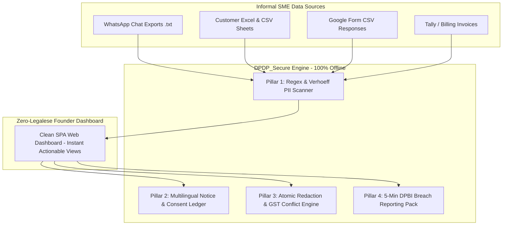

# DPDPA for Small Business
### Practical Data Protection Compliance & Governance for Informal SME Systems
**Srujana Tech Fest 2026 | 48-Hour Software Hackathon (24–26 October 2026)**  
**Theme:** Legal Services | **Problem Statement ID:** LS-04  
**Project:** **DPDP_Secure** | **Evaluation Track:** Final Implementation & Deployment  

---

## 🚀 Quickstart & Complete Running Guide

DPDP_Secure provides two complementary compliance architectures to solve the diverse needs of Indian businesses under the **Digital Personal Data Protection Act, 2023 (DPDP Act)**:

### Architecture 1: DPDP_Secure Enterprise Privacy Centre (Node.js + Express + EJS)
A server-side rendered (SSR) privacy management portal with dark-themed glassmorphism UI, containing 55 comprehensive privacy and compliance views (Consent Ledger, DSR Workflows, RoPA Inventory, Cookie Scanners, Incident Reporting, and RBAC).

```powershell
# 1. Navigate to the DPDP_Secure portal directory
cd n:\chnayka\DPDP_Secure

# 2. Install dependencies (Node 18+)
npm install

# 3. Start the application
node server.js
```
* **Portal URL:** [http://localhost:3000](http://localhost:3000)
* **Key Modules:**
  * **Consent Ledger:** [http://localhost:3000/consent/ledger](http://localhost:3000/consent/ledger)
  * **Data Rights Requests (DSR):** [http://localhost:3000/privacy/requests](http://localhost:3000/privacy/requests)
  * **DPDPA Rights Workflows:** [http://localhost:3000/privacy/workflows](http://localhost:3000/privacy/workflows)
  * **Security Incidents & Breaches:** [http://localhost:3000/incidents/dashboard](http://localhost:3000/incidents/dashboard)
  * **RoPA & Data Assets:** [http://localhost:3000/inventory/ropa](http://localhost:3000/inventory/ropa)

---

### Architecture 2: DPDP_Secure Offline-First SME Engine (FastAPI + React 18)
A 100% offline-first local compute compliance engine designed specifically for micro-businesses and diagnostic clinics (e.g., Ramesh Kumar, clinic owner). It scans WhatsApp chat exports, runs atomic Excel formula-preserving redaction with openpyxl, and auto-resolves statutory CGST Act 6-year tax invoice retention locks.

```powershell
# Option A: 1-Click Startup from Repository Root (PowerShell)
.\start.ps1

# Option B: 1-Click Startup from Repository Root (Linux/macOS Bash)
chmod +x ./start.sh
./start.sh

# Option C: Manual Launch (Two Terminals)
# Terminal 1 - Backend (FastAPI on Port 8000):
cd backend
pip install -r requirements.txt
python -m uvicorn app.main:app --host 127.0.0.1 --port 8000 --reload

# Terminal 2 - Frontend (React 18 + Vite on Port 5173):
cd frontend
npm install
npm run dev
```
* **Dashboard URL:** [http://localhost:5173](http://localhost:5173) (or [http://localhost:8000](http://localhost:8000) when served via FastAPI bundle)
* **Interactive API Swagger Docs:** [http://localhost:8000/docs](http://localhost:8000/docs)
* **Key Features:**
  * **Pillar 1 (Data Map / RoPA):** Local PII scanner for Indian Phone, PAN (4th char `'P'`), 12-digit Aadhaar via **Verhoeff algorithm**, UPI IDs, and clinical notes.
  * **Pillar 2 (Notices & Consent):** Section 5 multilingual notices in **English, Kannada, and Hindi** with WhatsApp click-to-copy templates.
  * **Pillar 3 (Rights & Erasure):** Section 11 access and Section 12 atomic spreadsheet redaction preserving `=SUM()` and `=VLOOKUP()`, with CGST 6-year tax retention locks and SHA-256 certificates.
  * **Pillar 4 (Breach Triage):** 5-minute Section 8(6) statutory DPBI regulatory notification pack generator.

---

## 1. Problem Statement & Scope (LS-04)

### Problem Statement: LS-04
> **Personal Data in Informal Systems (Data Protection for Small Businesses)**
>
> **Context:** India's *Digital Personal Data Protection Act, 2023 (DPDP Act)* applies to businesses of every size that handle personal data digitally, and its rules are being phased in. A typical SME stores customer, employee, and patient data across WhatsApp chats, Google Forms, Excel sheets, billing software, CCTV systems, and personal phones. Most could not tell you what personal data they hold, where it sits, why they collected it, or how they would respond if a customer asked for it to be erased. They also could not say what they would do in a breach.
>
> **The Challenge:** Build a solution that helps a small business reach practical, demonstrable data protection compliance without a dedicated privacy team: finding out what personal data it handles, managing consent and purpose, responding to individuals' rights requests, and being prepared for a breach.

---

## 2. Target User Persona: Ramesh Kumar

* **Name:** Ramesh Kumar
* **Role:** Managing Partner, *Aarogya Diagnostic Center & Polyclinic* (Bengaluru)
* **Scale:** 14 staff members, 1 doctor, 3 phlebotomists, 6,200 patient records collected over 3 years.
* **The Reality of Indian SMEs:**
  * Patients WhatsApp their prescriptions, test requirements, and ID proofs to the clinic reception phone.
  * Staff maintain patient contact numbers, test dues, and addresses across 8 different unencrypted Excel spreadsheets.
  * Invoices are stored in local accounting software and desktop billing CSVs.
  * Zero dedicated IT team, no Chief Privacy Officer (CPO), and zero budget for enterprise software ($10,000+ platforms).

### The Core Problem in Informal Systems
1. **Zero Visibility (Shadow PII):** Cannot map which patient records exist across scattered informal files.
2. **Missing Lawful Notice & Consent:** PII is collected ad-hoc over chat without Section 5 itemised notices or recorded affirmative consent.
3. **The "Right to be Forgotten" Dilemma:** Manually deleting customer rows across spreadsheets breaks Excel formulas (`=SUM()`, `=VLOOKUP()`) and causes `#REF!` errors.
4. **The Tax vs. Privacy Conflict:** When a customer demands complete deletion, small businesses risk violating **Section 36 of the CGST Act, 2017** (mandatory 6-year invoice retention).
5. **Breach Panic:** When an unencrypted phone or laptop is lost, the business suffers a reportable Personal Data Breach under **Section 8(6)** with potential penalties up to **₹200 Crore** due to failure to notify the Data Protection Board of India (DPBI).

---

## 3. Statutory Grounding Matrix (DPDP Act, 2023)

| DPDP Act Provision | Statutory Mandate | SME Challenge in Informal Systems | DPDP_Secure Solution Mechanism |
|---|---|---|---|
| **Section 2(i) & 2(j)** | Defines **Data Fiduciary** and **Data Principal**. | SMEs wrongly assume small scale exempts them. | Grounds the SME owner as a statutory Data Fiduciary with enforceable legal obligations. |
| **Section 5(1) & 5(3)** | **Notice Requirement:** Itemised notice before/at consent in plain language (Eighth Schedule languages). | Data collected informally over WhatsApp without formal notice. | **Multilingual Notice Generator:** Auto-builds compliant notices in **English, Hindi, and Kannada**. |
| **Section 6(1) & 6(4)** | **Consent Standard:** Free, specific, informed, unconditional, and affirmative. Ease of withdrawal must equal ease of giving. | No record of who agreed to what purpose. | **Affirmative Consent Ledger:** Logs timestamps, notice versions, and channels (WhatsApp `YES`, web form, paper slip). |
| **Section 8(5)** | **Security Safeguards:** Reasonable technical measures to prevent personal data breaches. | Plain-text spreadsheets and chat backups stored on shared staff desktops. | **Local PII Scanner & RoPA Mapper:** Pinpoints high-risk unencrypted files containing PAN/Aadhaar. |
| **Section 8(6)** | **Mandatory Breach Reporting:** Must intimate DPBI and affected Data Principals upon a personal data breach. | SME owners panic and hide incidents, risking ₹200 Cr penalties. | **5-Minute Breach Incident Wizard:** Auto-drafts official DPBI regulatory filings and customer SMS notices. |
| **Section 8(7) & Sec 12(2)** | **Storage Limitation & Erasure:** Erase personal data once purpose is fulfilled or consent withdrawn, **unless retention is required by law**. | Erasing accounting records violates **CGST Act Section 36** (6-year retention rule). | **Statutory Conflict Resolver:** Retains financial invoice data for 6 years while wiping marketing tags, issuing a verified **Retention Certificate**. |
| **Section 11** | **Right to Access:** Summary of processed data and list of third-party processors shared with. | Customer data scattered across 15 files cannot be retrieved quickly. | **One-Click DSR Access Report:** Produces a unified summary of all customer data points in seconds. |
| **Section 12(1)** | **Right to Correction & Updating:** Right to correct inaccurate or misleading personal data. | Updating data across multiple spreadsheets leads to mismatched records. | **Atomic Spreadsheet Engine:** Updates records across indexed informal files simultaneously. |
| **Section 33 & Schedule** | **Penalties:** Up to **₹250 Crore** for security failures; up to **₹200 Crore** for failing to report breaches. | Single breach or complaint can cause business bankruptcy. | Provides defensive audit trails, SHA-256 erasure certificates, and demonstrable compliance evidence. |

---

## 4. Technical Architecture: 100% Offline-First Local Compute

* **Privacy-by-Design:** Cloud-based privacy tools paradoxically introduce privacy violations by uploading sensitive SME files (containing customer Aadhaar numbers and patient medical notes) to third-party cloud servers.
* **Our Approach:** All scanning, parsing, redaction, and reporting run **100% locally on the SME owner's machine**. Zero cloud leakage, zero subscription costs, and works completely offline during network disruptions.



---

## 5. Technology Stack Selection

| Layer | Component | Technical Justification |
|---|---|---|
| **SME Frontend UI** | **React 18 (Vite) + Custom Glassmorphic CSS** | Highly responsive component-driven architecture, interactive stateful RoPA data tables, and dynamic progress indicators. |
| **Enterprise Portal** | **Node.js + Express + EJS** | 55 server-rendered views for complete organizational privacy governance and role-based administration. |
| **Backend Framework** | **Python 3.11+ / FastAPI** | High-performance asynchronous execution, clean RESTful endpoints, self-documenting Swagger/OpenAPI interface. |
| **Spreadsheet Engine** | **openpyxl & pandas** | Cell-level XML manipulation for Excel; preserves formula dependencies (`=SUM()`, `=VLOOKUP()`), styles, and sheet structures. |
| **PII & Pattern Engine** | **Compiled Python `re` + Verhoeff Algorithm** | Deterministic, zero-hallucination execution; processes 10,000 rows in under 2 seconds locally. |
| **Audit & Security** | **SQLite + hashlib (SHA-256)** | Cryptographic proof certificates of erasure and statutory tax locks stored in embedded local SQLite. |

---

## 6. Official Evaluation Criteria & Hackathon Schedule

### Official 100-Point Evaluation Rubric
| Criterion | Weight | Key Expectations from Evaluation Guide |
|---|---|---|
| **Problem Statement** | **15 pts** | Alignment with LS-04, clarity, depth of understanding, intended SME users, assumptions, and constraints. |
| **Tech Strategy** | **20 pts** | 100% Offline-First architecture, tool selection, data design, and technical planning. |
| **Implementation** | **25 pts** | Execution quality, working prototype, code logic, functional completeness, reliability, and automated testing. |
| **Presentation** | **20 pts** | Clear storytelling, demo quality, ability to answer tough questions and explain design decisions. |
| **Viability & Impact** | **20 pts** | Real-world usefulness for 63M Indian MSMEs, practical feasibility, risk management, and scalability. |

---

## 7. Professional Boundaries & Statutory Disclaimer

*In accordance with Rule 139 of Srujana Tech Fest 2026:*
> **Disclaimer:** *DPDP_Secure* is an operational compliance and technical governance prototype designed to assist small enterprises in implementing data protection safeguards under the Digital Personal Data Protection Act, 2023. Automated notices, reports, and assessments do not constitute formal legal counsel or binding legal advice.
